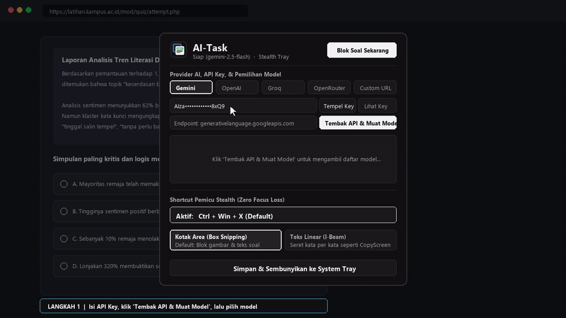

<div align="center">
  
  <h1>AI-Task</h1>
  <p><strong>Asisten Penjawab Soal Latihan Layar Ultra-Ringan (Pure Rust) dengan Stealth Overlay &amp; Hybrid Vision + OCR</strong></p>
  <p>
    <a href="https://github.com/Davinsry/AI-Task/releases/latest"><strong>Download AI-Task Portable (.exe)</strong></a>
    ·
    <a href="./LICENSE">MIT License</a>
  </p>
</div>

---

## Video & Animasi Tutorial Penggunaan

<div align="center">
  
  <p><em>Video tutorial resolusi penuh tersedia di <a href="./assets/demo.mp4">assets/demo.mp4</a></em></p>
</div>

---

## Tentang AI-Task

**AI-Task** adalah utilitas *open-source* (**MIT License**) berbasis **100% Pure Rust + Native Windows API (`Win32`, `Direct2D`, `DirectWrite`, `OneOCR`, &amp; `WinHTTP`)** yang membantumu menjawab soal latihan apa pun yang tampil di layar (web kuis, PDF, gambar, video, maupun dokumen) hanya dengan menekan **`Ctrl + Win + X`** lalu memblok area soalnya.

Dirancang tanpa Electron, tanpa WebView, dan tanpa *runtime* tambahan sehingga ukuran file `.exe` hanya sekitar **`~570 KB`** dan berjalan sangat ringan di *System Tray*.

---

## Fitur Utama

- **100% Stealth &amp; Zero Focus Loss (`WS_EX_NOACTIVATE`)**
  - Saat shortcut **`Ctrl + Win + X`** ditekan, tombol `keydown` dan `keyup` ditelan langsung di level OS (`WH_KEYBOARD_LL`) agar tidak bocor ke halaman web.
  - Baik saat overlay seleksi layar aktif maupun saat **Floating Stealth Answer HUD** menampilkan jawaban, fokus jendela browser tidak pernah berpindah (`window.onblur` dan `visibilitychange` tidak akan terpicu).
  - Tersedia juga shortcut **100% Tanpa Keyboard** (`Tombol Samping Mouse / Back`) dan `Ctrl + Win + Klik Kiri`.
- **Pembacaan Soal Hybrid (Gambar Vision + Teks OCR)**
  - Area yang kamu blok otomatis dipotong menjadi gambar `PNG` **sekaligus** diekstrak teksnya menggunakan *Windows 11 OneOCR* (`oneocr.dll` / `Windows.Media.Ocr`), lalu keduanya dikirim bersama ke AI agar teks, rumus, tabel, maupun diagram terbaca akurat.
- **Format Jawaban Adaptif Sesuai Tipe Soal**
  - **Soal Pilihan Ganda:** Langsung menampilkan badge opsi tegas (misalnya **`OPSI B`**) beserta kalimat opsi lengkap dan alasan singkat 1 kalimat.
  - **Soal Esai / Uraian ("Jelaskan..."):** Menampilkan inti jawaban dan penjelasan lengkap yang bisa di-*scroll* dengan *mouse wheel* serta otomatis tersalin ke *Windows Clipboard*.
- **Input API Key Manual &amp; Muat Daftar Model Otomatis (`/models`)**
  - Mendukung **Google Gemini**, **OpenAI**, **Groq**, **OpenRouter**, dan **Custom OpenAI-Compatible URL** (termasuk Ollama lokal).
  - Masukkan *API Key* secara manual, klik **`Tembak API &amp; Muat Model`**, lalu pilih langsung model yang tersedia dari daftar resmi provider tersebut.

---

## Panduan Penggunaan Langkah demi Langkah

### 1. Pengaturan Awal (API Key &amp; Pemilihan Model)
1. Jalankan **`AI-Task.exe`** (ikon aplikasi akan muncul di *System Tray* Windows dan jendela pengaturan `#111111` terbuka otomatis).
2. Pilih tab **Provider AI** yang ingin digunakan (`Gemini`, `OpenAI`, `Groq`, `OpenRouter`, atau `Custom URL`).
3. Klik kotak **API Key** lalu ketik / tempel (`Tempel Key` atau `Ctrl + V`) kunci API kamu.
4. Klik tombol **`Tembak API &amp; Muat Model`** untuk mengambil daftar model dari API provider tersebut, lalu klik model yang ingin kamu gunakan (atau ketik nama model secara manual).
5. Klik **`Simpan &amp; Sembunyikan ke System Tray`** agar AI-Task siap dipanggil kapan saja.

### 2. Menjawab Soal dari Layar
1. Buka halaman soal latihan atau PDF yang ingin dikerjakan.
2. Tekan **`Ctrl + Win + X`** (shortcut default, bisa diubah di pengaturan).
3. **Seret kotak** (`Kotak Area`) mengelilingi soal dan pilihan jawabannya, lalu lepas klik kiri.
4. Layar langsung kembali normal dan **Floating Stealth Answer HUD** muncul di samping soal dengan jawabannya. Kamu bisa langsung mengklik jawaban di halaman soal tanpa menutup HUD atau memindahkan fokus.

### 3. Kontrol Saat Overlay &amp; HUD Aktif

| Aksi | Fungsi |
| :--- | :--- |
| **Seret Klik Kiri (Drag &amp; Release)** | Memblok area soal (`Kotak Area` default) &amp; langsung mengirim ke AI |
| **Tahan `Shift` / `Alt` + Seret** | Beralih sementara antara mode `Kotak Area` dan `Teks Linear` |
| **Tombol `Jawab Layar`** | Mengirim seluruh tampilan layar ke AI tanpa perlu memblok manual |
| **Scroll Mouse pada HUD** | Menggulir jawaban atau penjelasan yang panjang |
| **Drag Header HUD** | Memindahkan posisi kartu jawaban ke area layar lain |
| **`Ctrl + C` / Tombol `Salin Jawaban`** | Menyalin jawaban AI ke *Windows Clipboard* |
| **`Esc` / Klik Kanan / Tombol `Tutup`** | Menutup overlay atau kartu jawaban |

---

## Build dari Source (Rust)

Pastikan menggunakan Windows 10/11 dan sudah memasang [Rust (`rustup`)](https://rustup.rs/).

```powershell
# 1. Clone repositori
git clone https://github.com/Davinsry/AI-Task.git
cd AI-Task

# 2. Jalankan seluruh unit test
cargo test

# 3. Build binary release
cargo build --release
```

File hasil kompilasi akan tersedia di `target/release/ai-task.exe`.

---

## Lisensi

Proyek ini dilisensikan di bawah [**MIT License**](./LICENSE).
